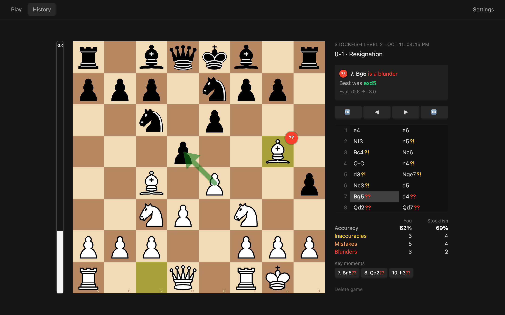
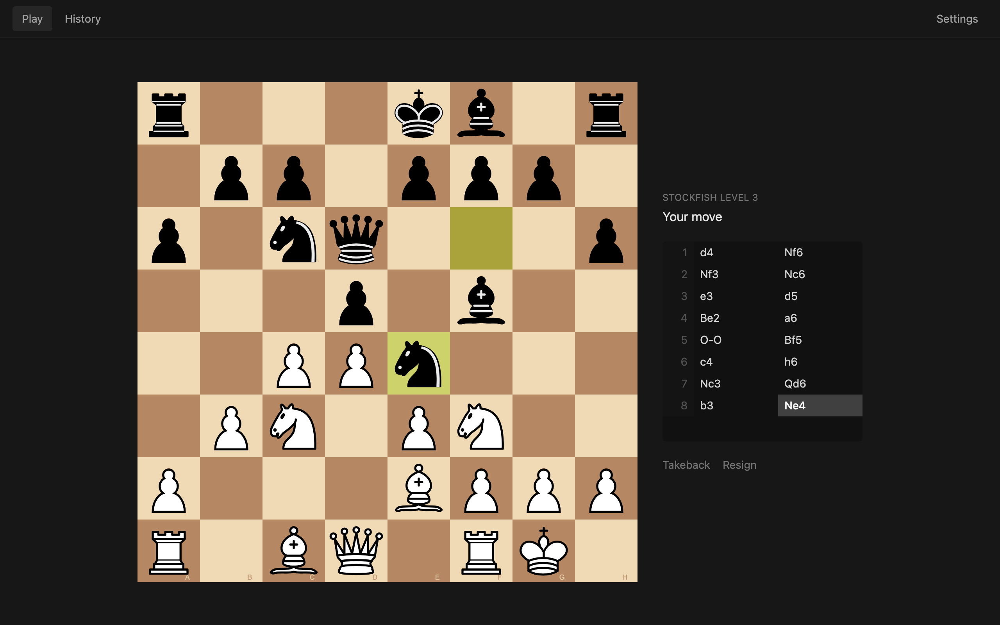
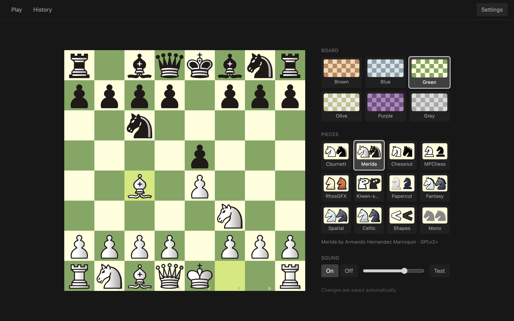
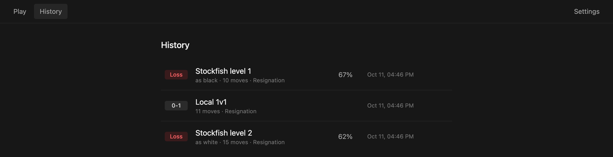

<div align="center">


# lochess

**A quiet, local chess app for getting better at chess.**<br>
Play Stockfish at lichess's beginner-friendly levels, then see exactly where each game turned.

[](https://github.com/katistix/lochess/releases/latest)
[](LICENSE)




</div>

## Features

- **Play Stockfish at levels 1–8**, using the same engine and settings lichess uses for its AI, so even level 1 is beatable.
- **Review every game.** Each move is graded from *Best* to *Blunder*, with the better move drawn on the board, an eval bar, accuracy for both sides and the three moments that mattered most.
- **Your history, kept locally.** Every finished game is saved and analysed in the background, ready when you are.
- **Local 1v1** on one board, with takebacks and draws by agreement.
- **Make it yours.** 6 board colours, 12 open-licensed piece sets from lichess, and move sounds.
- **Private by design.** No account and no network: games, analysis and settings stay on your computer.

## Install

One command, no dependencies to set up: the chess engine ([Fairy-Stockfish](https://fairy-stockfish.github.io/)) ships inside the app. Run it again any time to update.

**macOS** (Apple Silicon and Intel) and **Linux** (x86-64):

```bash
curl -fsSL https://raw.githubusercontent.com/katistix/lochess/main/install.sh | sh
```

**Windows** (10 and 11), in PowerShell:

```powershell
irm https://raw.githubusercontent.com/katistix/lochess/main/install.ps1 | iex
```

Prefer clicking? Download the [latest release](https://github.com/katistix/lochess/releases/latest): `lochess-windows-amd64-setup.exe` for Windows, `lochess-macos.zip`, or `lochess-linux-amd64.tar.gz`.

<details>
<summary>Platform notes</summary>

- **macOS**: installs `lochess.app` into `/Applications` (or `~/Applications`). The app isn't notarised yet. The script avoids Gatekeeper's warning, but a zip downloaded in a browser needs right-click → **Open** the first time.
- **Linux**: installs `~/.local/bin/lochess` and adds it to your applications menu. It needs WebKitGTK 4.1, which the script installs with apt, dnf, pacman or zypper if it's missing (this may ask for your password). It works on Ubuntu 22.04+, Debian 12+, Fedora, Arch and openSUSE.
- **Windows**: installs to `%LOCALAPPDATA%\Programs\lochess` with a Start menu shortcut, with no admin rights needed. The setup `.exe` isn't code-signed, so SmartScreen may warn: choose **More info → Run anyway**. lochess uses Microsoft Edge WebView2, which Windows 10 and 11 already have.

</details>

<details>
<summary>Uninstall</summary>

| | |
|---|---|
| macOS | `rm -rf /Applications/lochess.app ~/Library/Application\ Support/lochess ~/Library/Caches/lochess` |
| Linux | `rm -rf ~/.local/bin/lochess ~/.local/share/applications/lochess.desktop ~/.local/share/icons/hicolor/256x256/apps/lochess.png ~/.config/lochess ~/.cache/lochess` |
| Windows | Delete `%LOCALAPPDATA%\Programs\lochess`, `%APPDATA%\lochess`, `%LOCALAPPDATA%\lochess` and the Start menu shortcut, or use *Add or remove programs* if you used the setup `.exe` |

</details>

## Screenshots

<table>
  <tr>
    <td width="50%"></td>
    <td width="50%"></td>
  </tr>
  <tr>
    <td align="center"><sub>Playing Stockfish level 3</sub></td>
    <td align="center"><sub>Boards, piece sets and sounds, with a live preview</sub></td>
  </tr>
</table>



## How it works

### Bot levels

Stockfish is far too strong for beginners, even at its lowest setting. lochess copies lichess's approach instead ([fishnet](https://github.com/lichess-org/fishnet)): it plays with **Fairy-Stockfish** using classical evaluation, a limited search, and a *Skill Level* that goes below zero. Official Stockfish can't do that.

| Level | 1 | 2 | 3 | 4 | 5 | 6 | 7 | 8 |
|---|---|---|---|---|---|---|---|---|
| Skill | −9 | −5 | −1 | 3 | 7 | 11 | 16 | 20 |
| Depth | 5 | 5 | 5 | 5 | 5 | 8 | 13 | 22 |
| Time | 50 ms | 100 ms | 150 ms | 200 ms | 300 ms | 400 ms | 500 ms | 1 s |

### Move grades

After a game, a full-strength engine evaluates every position. Each evaluation becomes a winning chance (lichess's formula), and a move is graded by how much winning chance it gave away, using chess.com's thresholds:

| Best | Excellent | Good | Inaccuracy `?!` | Mistake `?` | Blunder `??` |
|---|---|---|---|---|---|
| engine's choice | < 2% | < 5% | < 10% | < 20% | ≥ 20% |

Accuracy uses lichess's per-move formula, and *key moments* are your three costliest mistakes.

### Your data

Everything lives in your user config folder (`~/Library/Application Support/lochess` on macOS, `~/.config/lochess` on Linux, `%APPDATA%\lochess` on Windows): one JSON file per game in `games/`, your settings, and an unfinished game, which is restored when you reopen the app.

## Development

Requires [Go](https://go.dev), [Node](https://nodejs.org) with [pnpm](https://pnpm.io), the [Wails v2 CLI](https://wails.io/docs/gettingstarted/installation) (plus its [platform dependencies](https://wails.io/docs/gettingstarted/installation#platform-specific-dependencies)) and a Fairy-Stockfish on your `PATH` (e.g. `brew install fairy-stockfish`). Development builds use the installed engine; release builds bundle one.

```bash
wails dev               # run with hot reload
wails build             # build build/bin/lochess.app
go test ./...           # backend tests (engine tests skip without Fairy-Stockfish)
```

Set `LOCHESS_DATA_DIR` to run against a separate data folder, e.g. for testing without touching your own games.

To build a self-contained app like the releases, bundle the engine first:

```bash
scripts/fetch-engine.sh darwin     # or linux / windows
wails build -tags bundled_engine   # Linux also needs: -tags "webkit2_41 bundled_engine"
```

<details>
<summary>Project layout</summary>

Go owns all game state and logic. The frontend only renders it and sends moves back.

| Path | |
|---|---|
| `main.go`, `app.go` | Wails entry point and the thin binding layer exposed to the frontend |
| `internal/game` | Rules and authoritative game state ([notnil/chess](https://github.com/notnil/chess)) |
| `internal/engine` | UCI subprocess wrapper |
| `internal/bot` | lichess AI levels 1–8 on Fairy-Stockfish, with crash recovery |
| `internal/match` | A game plus its mode, level and colours; saves finished games, resumes unfinished ones |
| `internal/history` | Finished games as JSON files |
| `internal/analysis` | Move grades, accuracy and key moments |
| `internal/review` | Runs and caches analysis on a dedicated full-strength engine |
| `internal/settings` | Display and sound preferences |
| `frontend/` | Vite, React, TypeScript, Tailwind v4 and [chessground](https://github.com/lichess-org/chessground) |
| `frontend/src/routes/` | File-based routes ([TanStack Router](https://tanstack.com/router)) |
| `frontend/wailsjs/` | Generated Go bindings (do not edit) |
| `internal/engine/bundled/` | Where `scripts/fetch-engine.sh` puts the engine for release builds |
| `install.sh`, `install.ps1` | One-line installers (macOS + Linux, Windows) |
| `.github/workflows/release.yml` | Builds and tests all platforms on PRs; publishes releases on tags |

</details>

### Releasing

Push a version tag. GitHub Actions bundles the engine, then tests and builds macOS (universal), Linux and Windows (zip and setup `.exe`), and publishes the release the installers download:

```bash
git tag -a v0.1.1 -m "lochess v0.1.1" && git push origin v0.1.1
```

## Credits

- [lichess](https://lichess.org): the board ([chessground](https://github.com/lichess-org/chessground)), bot levels and piece sets. Authors and licences are in [`frontend/src/assets/pieces/CREDITS.md`](frontend/src/assets/pieces/CREDITS.md).
- [Fairy-Stockfish](https://fairy-stockfish.github.io/), the chess engine (GPL-3.0), bundled in releases; source at [fairy-stockfish/Fairy-Stockfish](https://github.com/fairy-stockfish/Fairy-Stockfish).
- [notnil/chess](https://github.com/notnil/chess), the move generation and rules.
- [Kenney](https://kenney.nl), the sounds (CC0), credited in [`frontend/src/assets/sounds/CREDITS.md`](frontend/src/assets/sounds/CREDITS.md).

## License

[GPL-3.0-or-later](LICENSE). Piece sets and sounds keep their own licences, listed in their `CREDITS.md` files.
